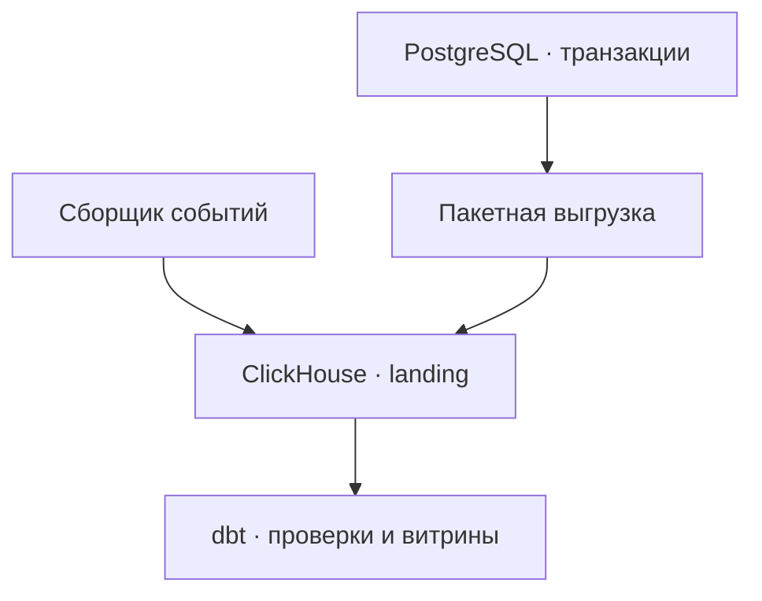

# Архитектура QuickBite Analytics Platform

[Словарь данных](../data_model/data_dictionary.md) описывает источники. [Связи и кейсы](../data_model/relationships.md) задают правила расчёта. [ADR-0001](decisions/0001-postgresql-clickhouse.md) фиксирует выбор хранилищ.

PostgreSQL хранит восемь транзакционных сущностей. ClickHouse принимает продуктовые события и аналитические копии. Модели dbt будут выполнять SQL и проверки в ClickHouse после загрузки.

## Пакетная загрузка MVP

Загрузчик Stage 3 сериализует запуск на уровне PostgreSQL и читает восемь таблиц из одного снимка. В ClickHouse он создаёт отдельную базу для пакета, копирует транзакционные данные и продуктовые события, проверяет ключи, связи, количество строк и денежные суммы. В той же транзакции PostgreSQL, что и импорт, обновляется единственный указатель на проверенную аналитическую базу. При ошибке читатели сохраняют предыдущую версию. Повтор с неизменившимся источником сохраняет активное имя.

Моменты хранятся в UTC. Для календаря отчёта применяется `Europe/Moscow`, для панели DiD — зафиксированная зона ресторана. PostgreSQL хранит RUB в копейках, агрегаты используют расширенный целочисленный тип.

[Инструкция Stage 3](../stage-3.md) описывает запуск, повтор и проверку. Модели dbt, CDC и отдельный каталог релизов относятся к следующим этапам.
