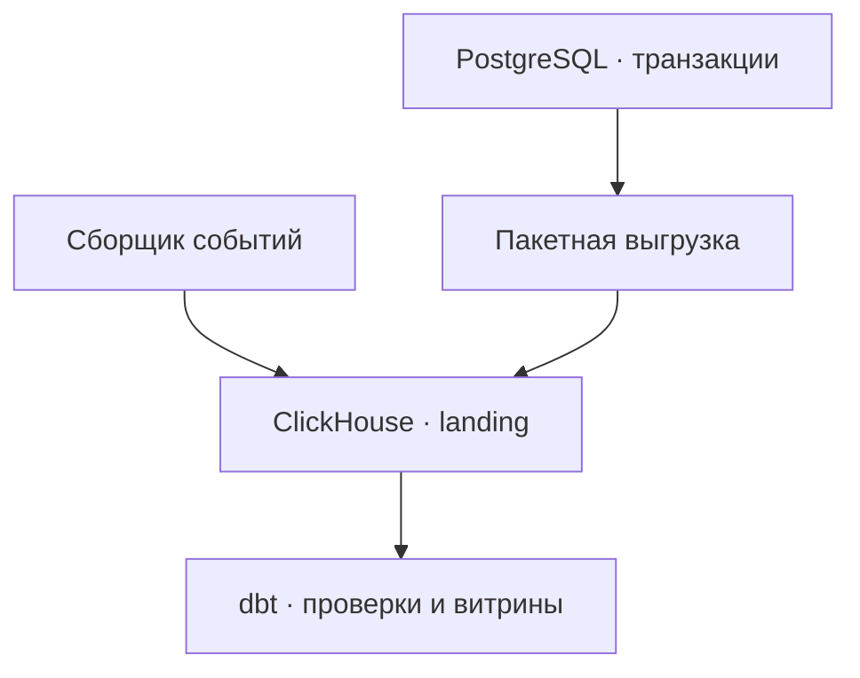

# Архитектура QuickBite Analytics Platform

[Словарь данных](../data_model/data_dictionary.md) описывает источники. [Связи и кейсы](../data_model/relationships.md) задают правила расчёта. [ADR-0001](decisions/0001-postgresql-clickhouse.md) фиксирует выбор хранилищ.

PostgreSQL хранит восемь транзакционных сущностей. ClickHouse принимает продуктовые события и аналитические копии. Модели dbt будут выполнять SQL и проверки в ClickHouse после загрузки.

## Пакетная загрузка MVP

1. Один загрузчик читает восемь таблиц PostgreSQL в одной транзакции `REPEATABLE READ READ ONLY`. Вход пакета фиксирует UTC-время среза, количество строк и границу приёма событий.
2. Загрузчик полностью наполняет отдельную staging-таблицу для каждого источника. Перед повтором незавершённой попытки staging очищается. После сверки количества строк и ключей загрузчик заменяет содержимое соответствующей landing-таблицы целиком, например через `EXCHANGE TABLES` в базе `Atomic`. Одинаковый вход даёт одинаковые ключи и суммы, повтор загрузки не добавляет строки.
3. Окно запуска имеет одного писателя. После публикации всех таблиц сверяются логические FK и суммы платежей. Только затем запускаются модели dbt. Если запись оборвалась между таблицами, следующий запуск полностью перестраивает тот же набор. Публикация атомарна по таблице, поэтому чтение landing и обновление витрин должны выполняться вне окна замены.
4. У события стабильный `event_id`. На входе повтор пакета сохраняет ID. Канонизация выбирает одну строку по ID и сверяет бизнес-поля. Начальное время приёма берётся по минимуму. Конфликтующие строки отправляются на разбор. Факты, родители которых ещё не пришли, ждут следующей загрузки.

Снимок источника и полнота бизнес-окна учитываются отдельно. Отчёт использует последнее успешно проверенное окно. Неполные этапы доставки остаются `NULL`, время хранится в UTC. Для календаря отчёта применяется `Europe/Moscow`, для панели DiD — зафиксированная зона ресторана. PostgreSQL хранит RUB в копейках, агрегаты используют расширенный целочисленный тип.

В Stage 2 реализуются контейнеры, SQL-схемы, небольшой детерминированный seed и проверка его повторного применения. Выгрузка PostgreSQL и dbt относятся к следующему этапу. CDC, WAL и каталог версий рассматриваются при росте объёма или требованиях к свежести.
