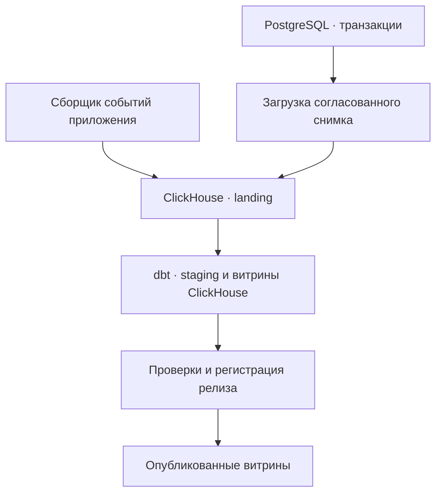

# Архитектура QuickBite Analytics Platform

Статус — проект Stage 1 для ревью. [Словарь данных](../data_model/data_dictionary.md) описывает контракты источников, [связи и кейсы](../data_model/relationships.md) — правила расчёта, а [ADR-0001](decisions/0001-postgresql-clickhouse.md) — выбор хранилищ и последствия.

PostgreSQL хранит восемь транзакционных сущностей с ограничениями и атомарными бизнес-операциями. Сборщик отправляет телеметрию приложения в ClickHouse. dbt Core с адаптером `dbt-clickhouse` читает ClickHouse и выполняет SQL staging, intermediate и marts в ClickHouse. Вычислительная нагрузка витрин остаётся в аналитическом хранилище.

## Загрузка PostgreSQL → ClickHouse для MVP

1. Один загрузчик открывает транзакцию PostgreSQL `REPEATABLE READ READ ONLY`. Он устанавливает снимок первым чтением, фиксирует метаданные среза и выгружает все восемь таблиц в той же транзакции. Для каждого источника сохраняются схема, количество строк и контрольная сумма канонического представления. Снимок согласует состояние таблиц, а бизнес-границы покрытия передаются отдельно. Таблицы читаются в стабильном порядке PK. Пределы выгрузки задаются таким образом, чтобы небольшая модель полностью считывалась в рамках одного запуска.
2. Один запуск закрепляет входные файлы снимка, watermark телеметрии, подтверждённые границы покрытия источников и версию кода. Манифест входа хранит упорядоченные контрольные суммы таблиц и идентификаторы источников. Хеш манифеста идентифицирует релиз. Повтор с тем же манифестом, если релиз уже опубликован, завершает работу без новых вставок. Повтор с иным cutoff, watermark или кодом считается новым релизом даже при совпадении содержимого таблиц.
3. Каждая попытка пишет в изолированные таблицы ClickHouse. При потере подтверждения INSERT попытку помечают неуспешной и пересобирают в чистом пространстве под тем же входом. Частичный набор никогда не дописывается вслепую. dbt строит полный набор витрин этой попытки и выполняет проверки ключей, ссылок, grain, покрытия и сверку денежных сумм по валюте с проводками. Повторные попытки сериализуются, включая время между проверками и публикацией.
4. После успеха загрузчик регистрирует релиз и переключает один указатель на него в транзакции служебного каталога. Указатель использует сериализацию и проверку монотонности поколения, чтобы запоздавший повтор не заменил более свежий релиз. Потребитель один раз читает активный указатель и закрепляет набор таблиц на весь запрос или сессию. Публикация не зависит от независимых переключений восьми таблиц ClickHouse. Предыдущий релиз хранится до окончания окна отката и чтений. Служебный каталог и манифесты описывают загрузку и не входят в бизнес-модель.
5. История сохраняется в исходных статусах и проводках, контекст — в фактах. Технические снимки предназначены для воспроизводимости релизов. Повторный расчёт исторического отчёта использует закреплённый релиз, `as_of` и версию протокола. Позднее изменение входит в следующий релиз. Для неизменяемых фактов проверяется отсутствие неожиданных удалений и правок. Для разрешённых изменений в карточках снимок показывает состояние на момент выгрузки.

Для MVP предложены полные снимки и полные перестроения витрин. Они покрывают вставки, изменения и удаления разрешённых данных в одном срезе и не зависят от `updated_at`, который в этой модели отсутствует. Потребление ресурсов растёт с объёмом. Нагрузка на PostgreSQL, SLA свежести, длительность сборки и срок хранения снимков задают момент перехода на CDC.

## Телеметрия и поздние события

У сборщика есть стабильный идентификатор события и монотонная позиция приёма пакетами. Позиция — техническое поле landing-слоя. Watermark — наибольшая непрерывная позиция подтверждённых пакетов. Сборщик сохраняет позицию при повторе пакета, продвигает watermark после подтверждённой записи, разрывы отслеживает отдельно. Повтор может оставить несколько физических записей в landing. Staging выбирает один экземпляр на `event_id`, сохраняет первое время поступления и поднимает конфликт, если стабильные поля отличаются. Очистка истории попыток следует политике хранения.

Для каждой попытки фиксируется неизменяемый вход телеметрии до выбранного watermark. Его сохраняют как часть входа до истечения окна повторов. Набор опубликованных витрин материализован и не обращается к меняющемуся landing-слою при чтении. Появившиеся позже пользователи, заказы и назначения могут восстановить ссылки для телеметрии в следующем релизе. Пока родитель отсутствует, событие ждёт в landing. После согласованного окна ожидания запись попадает в отчёт о разрывах. События разделяют момент наступления и время приёма. Поздний показ может изменить диагностику A/B в новом релизе, исходная рандомизация и факт покупки берутся из PostgreSQL. Служебные границы покрытия источника учитывают допустимую задержку. Успешная выгрузка и наличие свежей строки сами по себе не устанавливают полноту бизнес-окна.

## Временные правила и деньги

- Моменты хранятся в UTC с микросекундами. Длительности считаются по UTC, календарные срезы — в закреплённой IANA-зоне. Для сравнения местных дней используется дата, а не деление секунд на 86 400. Дата отчёта остаётся стабильной при изменении карточки ресторана.
- Фактический cutoff у витрины определяется наименее свежим необходимым источником с подтверждённым покрытием. В интервалах используется включённая левая и исключённая правая граница. Пропущенные этапы и неизвестные обещания остаются `NULL`. В ClickHouse при внешнем JOIN выставляется `join_use_nulls = 1` или явно формируются nullable результаты.
- Суммы считаются в минимальных единицах целыми числами. Агрегация расширяет тип до `Int128` / `Decimal(38, 0)` до сложения. Суммы и отчёты группируются по валюте, масштаб для отображения берётся из её справочника. Знак возврата применяется один раз. Снимок суммы заказа в витрине и ledger используют один и тот же контракт проводок.
- При публикации проверяются counts по каждой сущности до и после передачи, уникальность ключей, допустимые значения, логические FK, неизменяемые факты, сверка сумм списаний и возвратов по валюте и соответствие grain витрин. Измеряются длительность загрузки, свежесть каждого источника, исключённые записи, конфликты событий и доля пропусков.

## Переход на CDC при росте объёма

Предлагаемый путь — снимок, согласованный с PostgreSQL logical replication slot, и последовательное чтение WAL от его согласованной позиции. Начальная загрузка читает экспортированный снимок слота, затем применяет изменения по границе, возвращённой источником, соблюдая порядок коммитов и изменений внутри транзакции. Для повтора ключ события CDC включает идентичность потока, позицию коммита и порядковый номер изменения. Загрузчик применяет только полные транзакции, а позицию продвигает после устойчивой записи их изменений. Публикация среза использует общий подтверждённый watermark транзакций. Операции удаления передаются как tombstone. Переинициализация слота и DDL-переходы требуют нового согласованного поколения.

Для состояния по PK в ClickHouse можно использовать `ReplacingMergeTree` со стабильным `ORDER BY`, монотонной версией, учитывающей порядок WAL, и маркером удаления. Каноническое состояние на текущую позицию вычисляется явно через `FINAL` над соответствующей таблицей состояния либо выбором последней версии со снятием tombstone после дедупликации. Все версии ключа должны иметь согласованную схему партиционирования. Фоновые merge происходят асинхронно. Снимки на прошлые позиции читаются из сохранённых релизов или неизменяемого журнала CDC, поскольку таблица текущего состояния может потерять старые версии при merge. Для инкрементальных dbt-моделей изменение или удаление статуса, платежа либо назначения инвалидирует затронутый заказ, пользователя, ресторан-день и соответствующие агрегаты. Стратегия обновления проверяется на повторе и backfill до перехода.

Документация [PostgreSQL logical decoding](https://www.postgresql.org/docs/15/logicaldecoding-explanation.html), [ClickHouse ReplacingMergeTree](https://clickhouse.com/docs/reference/engines/table-engines/mergetree-family/replacingmergetree) и [адаптера dbt-clickhouse](https://docs.getdbt.com/docs/local/connect-data-platform/clickhouse-setup).
