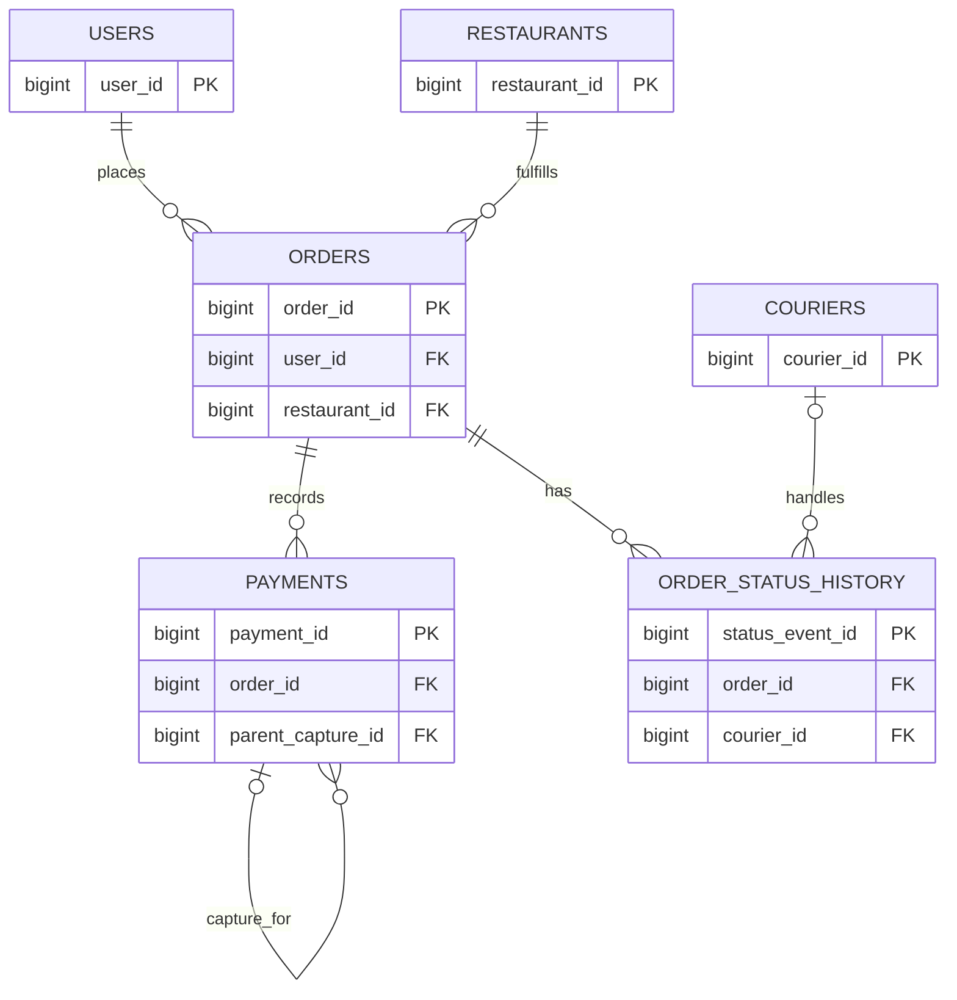
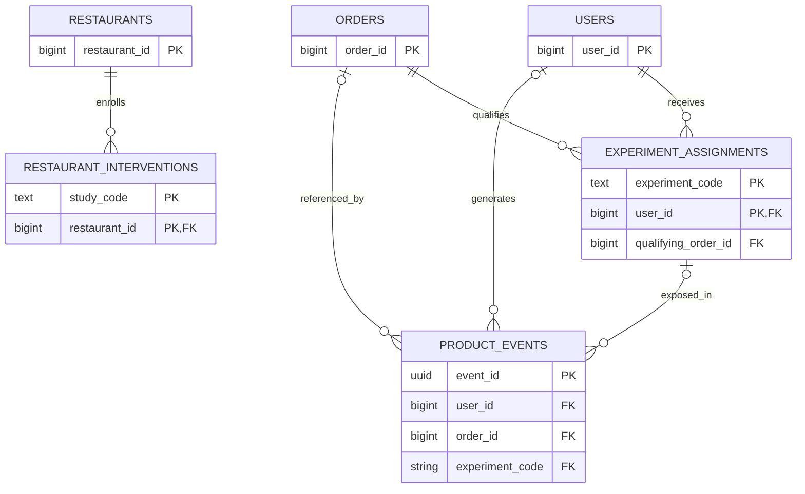

# Связи и проверка бизнес-кейсов

[Словарь данных](data_dictionary.md) задаёт физические поля источника и логические ключи ClickHouse. Диаграммы показывают один граф в двух частях. Общие узлы имеют одинаковые ключи.

## Заказ, платежи и доставка

## События и эксперименты

Для события показа ссылка на назначение составная, `(experiment_code, user_id)`. Для возврата ссылка на списание обязательна по правилу типа операции. В остальных строках этих сущностей соответствующие ссылки могут отсутствовать.

## Контракты витрин

| Модель | Grain и ключ | Назначение |
| --- | --- | --- |
| `int_order_lifecycle` | `order_id` | Один заказ с этапами, последним действующим на момент забора назначением курьера и признаками полноты |
| `int_order_payment_totals` | `(order_id, currency_code)`, по контракту одна валюта на заказ | Суммы операций для присоединения к заказу |
| `fct_payment_ledger` | `payment_id` | Проводки по дате подтверждения. Источник календарной выручки с учётом поздних возвратов |
| `mart_retention_monthly` | `(cohort_month, months_since_first_order)` | Размер когорты, число вернувшихся и доля вернувшихся |
| `mart_cohort_revenue_monthly` | `(cohort_month, posting_month, currency_code)` | Поступления, возвраты и расчётная выручка по платежным периодам и когортам |
| `mart_delivery_diagnostics` | `order_id` | Длительности и SLA для заказа, готовые к агрегации по срезам |
| `mart_repeat_order_itt` | `(experiment_code, user_id)` | Один бинарный исход на назначенного пользователя, плюс диагностические признаки |
| `mart_restaurant_did_daily` | `(study_code, restaurant_id, business_date)` | Панель ресторанов с объёмами, признаками покрытия и результатом SLA |

Платежи и статусы независимо приводятся к grain заказа перед соединением. Анализ событий строится отдельно на grain события либо сначала сворачивается в один флаг на ключ назначения. Витрины проверяют уникальность ключей и сохранение количества строк и денежных сумм после JOIN. Суммы проводок агрегируются без промежуточного JOIN с историей статусов.

### 1. Retention & Revenue Analytics

- Когорта — месяц первой доставки зарегистрированному покупателю в фиксированной зоне отчётности. Для MVP предлагается `Europe/Moscow`. При совпадении времени первой доставки порядок задаёт `order_id`. В периоде M+n считаются уникальные покупатели с хотя бы одной доставкой. Знаменатель — исходный размер когорты, M0 = 100%. Публикуются завершённые и покрытые данными месяцы. Для определения первого заказа нужна история с начала обслуживания пользователя. Когорты с усечённой историей маркируются и исключаются из этого отчёта.
- Реестр строится по всем подтверждённым списаниям и возвратам, включая возвраты по отменённым заказам. Период проводки определяется по `posted_at`. Когорта присоединяется по покупателю на дату среза, а операции покупателей без известной первой доставки попадают в отдельную категорию и участвуют в сверке. Поздний возврат уменьшает сумму месяца проводки. Отчёт сохраняет `as_of` для воспроизводимости.
- Чистые поступления равны списаниям клиентов минус возвраты. Расчётная выручка платформы равна списанным компонентам `platform_revenue_minor` минус их сторно. Календарный расчёт группирует по валюте. Операционный GMV, бухгалтерское признание выручки и валютная переоценка требуют отдельных правил.

### 2. Delivery Time Root Cause Analysis

- На один заказ выделяются четыре непересекающихся отрезка в секундах. Оформление → принятие, принятие → готовность, готовность → забор, забор → доставка. У полностью наблюдаемого доставленного заказа их сумма равна общей длительности. Первый и действующий при заборе курьеры, число переназначений и время назначения — отдельные диагностические признаки. Время назначения может пересекаться с приготовлением.
- Сравниваются медианы, p90 и доля просрочек по городу, ресторану, местному часу, диапазону расстояния и типу транспорта. Просрочка среди доставленных считается по исходному `promised_delivery_at` и только с известным обещанием. Отдельно публикуются доля отсутствующих обещаний, число отменённых заказов и покрытие каждого этапа.
- Отсутствующий этап даёт `NULL`, длительность по нему исключается только из расчёта этого этапа. Доля и характер пропусков показываются рядом. Нарушения порядка исключаются из расчёта длительностей с диагностикой. Срезы локализуют этап и сегмент задержки. Причинный вывод о нехватке курьеров потребует данных о сменах, спросе и доступности.

### 3. A/B Testing — Repeat Order

- Единица рандомизации и анализа — пользователь. В MVP предлагается повторная доставка за 14 суток после назначения. Новый заказ должен быть оформлен в `[assigned_at, assigned_at + 14 суток)` и доставлен до правой границы. Квалифицирующий заказ исключается по ID, несколько покупок дают один успех. Интервал считается в UTC как 336 часов. Окно наблюдения должно полностью завершиться к подтверждённому cutoff.
- ITT включает всех назначенных пользователей с полным окном, включая пользователей без показа и повторной покупки. До оценки эффекта сверяются доли вариантов с заданной аллокацией (SRM), уникальность назначения, равенство правил допуска и доля фактических показов. Событие показа используется для диагностики. При расхождении фактического варианта сохраняется исходное назначение и поднимается проверка.
- Результат — разность конверсий в п.п. с двусторонним интервалом, рассчитанным для двух биномиальных долей. Порог значимости, MDE, размер выборки, способ расчёта интервала и правила остановки фиксируются в протоколе до анализа. Незрелые назначения учитываются в диагностике набора отдельно.

### 4. Difference-in-Differences — Restaurant Capacity Management

- Сравнивается пилот управления пропускной способностью с заранее выбранными сопоставимыми ресторанами, которые продолжают работать по прежним правилам. Контрольным ресторанам назначается тот же календарный разрез pre/post. Группа определяется планом, фактический старт служит для проверки соблюдения. Если старт сдвинулся или запуск сорвался, первичный анализ сохраняет назначение, а анализ по фактическому старту маркируется как дополнительный.
- Панель строится на каждый заранее запланированный день ресторана в локальной зоне исследования по `placed_at`. Рекомендуемый первичный показатель — доля оформленных заказов, ставших готовыми в течение 30 минут после оформления. Это фиксирует скорость обслуживания входящего потока и учитывает отмены до готовности. Знаменатель — все заказы, оформленные в этот день с полностью наблюдаемым окном 30 минут. Просроченные и отменённые до готовности дают 0. При проблемах полноты источника день получает флаг покрытия, результат по нему блокируется до восстановления или явно описывается в анализе чувствительности.
- Панель сохраняет дни с нулём заказов. Для подтверждённого отсутствия заказов счётчики равны 0, доля равна `NULL`. Для основного контраста числители и знаменатели суммируются внутри пары ресторан × период, затем рестораны получают равный вес. Ресторан с нулевым знаменателем за целый период делает первичную оценку для исходной панели неопределённой. Публикуются причины и чувствительность к смене состава. Объём заказов и отмены показываются отдельно.
- Контраст равен `(post − pre) treatment − (post − pre) control`. До интерпретации эффекта проверяются динамика pre по неделям, сопоставимость объёма, географии и загрузки до пилота, параллельные акции, переток заказов между ресторанами и полнота логов. Неопределённость оценивается на уровне ресторана, с поправкой на малое число кластеров или с представлением результата как описательного. MVP предполагает общую дату запуска, при нескольких волнах потребуется групповой анализ по времени внедрения.

## Проверки на ревью

| Ошибка | Ожидаемая проверка |
| --- | --- |
| Два списания и один возврат соединены с четырьмя статусами | До JOIN привести источники к grain заказа. Для списаний 10 000 и 5 000 и возврата 3 000 чистые поступления равны 12 000, число заказов равно 1 |
| Возврат проведён в следующем месяце или валюта ошибочна | Возврат отражается в месяце `posted_at`. FK, сверка валюты и раздельные суммы по валютам проверяются до публикации |
| Отсутствующий этап заменён нулём или поставлены отрицательные длительности | Пропуски дают `NULL` и счётчик покрытия. Сумма четырёх последовательных этапов равна общей длительности для полных заказов |
| Назначен один курьер, забрал другой | Сверить последовательность переназначений с курьером события забора |
| Заказ на границе UTC-суток ушёл в соседний локальный день | Проверить момент `2026-01-31T21:30:00Z`. Для Москвы это 1 февраля, 00:30. Длительность A/B остаётся в UTC |
| В A/B взяты только увидевшие вариант или несколько заказов расширили знаменатель | Два назначения и один пользователь с двумя повторами дают 1 успех из 2 при полном календарном окне. Повтор у правой границы исключается |
| В DiD учтены только активные дни и сравниваются уровни post | Нулевой день остаётся в панели. Для treatment 60% → 75% и control 55% → 60% эффект равен +10 п.п. |
| Срезы смешали версии родительских и дочерних таблиц | Витрины используют одну версию PostgreSQL и один watermark событий. Проверка координат загрузки входит в контроль выпуска |
| Повторная доставка события или повторный запуск добавили строки | Проверить уникальность IDs и равенство итогов при повторе входа. Несовпадающий payload с тем же ID блокирует канонизацию ID |
| Текущая карточка поменяла исторический срез | Группировать по снимкам города, зоны и транспорта в фактах. Проверить, что обновление карточки не меняет ранее закрытый срез |
